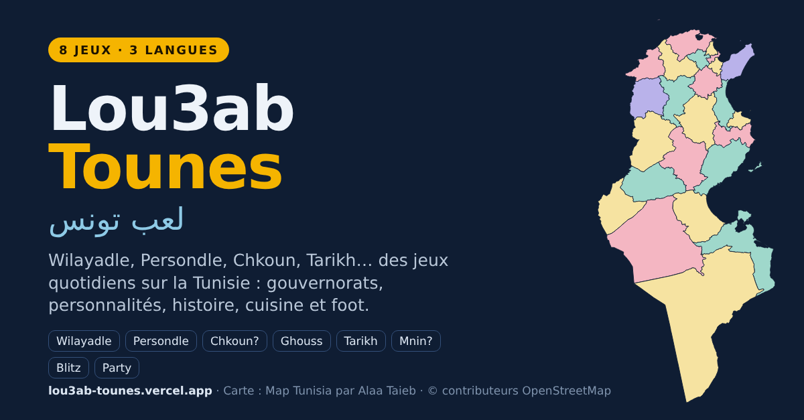

# Lou3ab Tunisia · لعب تونس

**Daily games to discover Tunisia: its governorates, its personalities, its history, its food, its festivals and its football.**
Free, no account needed, on phone or computer, in French, English and Arabic.

### ▶ Play now: **https://lou3ab-tounes.vercel.app**

---

## 🎯 The goal

Most Tunisians know their own governorate and a few big cities. Far fewer could place Siliana on a map, say which singer was born in Nebeur, or tell when Louis IX's crusade landed at Carthage to fight the Hafsid sultan al-Mustansir.
And for many people abroad, Tunisia stops at Carthage, Djerba and the beaches.

**Lou3ab Tunisia wants Tunisians and foreigners alike to know the country better, one short game a day.**
Win or lose, every round ends with something new learned: a place, a person, a date, a dish.

Every answer is checked: population and area come from the 2024 national census, the maps are precise down to each delegation, and every birthplace, date and fact is verified against reliable sources.

## 📅 New every day

The daily games change at **midnight**. Each day brings:

- a new **governorate** to guess, with a fun fact about it,
- a new **Tunisian personality**,
- a new **mystery** person or place,
- new **history** events, new **origin cards** and a new **higher-or-lower** theme.

When you finish a daily game, a countdown shows when the next one arrives. You can also replay past days with the ‹ › arrows.

You can see how you compare with everyone else: *"2,481 people already found it"*, *"You did better than 63% of players"*.
Every result can be copied and shared with your friends, Wordle-style. 🟩🟧🟥

---

## 🕹️ The games and how to play them

### 🗺️ Wilayadle · ولايدل *(daily)*
**Guess the governorate of the day.**
Type any governorate. Your guess appears as a row of cells comparing it with the answer:

| Column | What it tells you |
|---|---|
| Region | 🟩 same region · 🟧 same part of the country (north, centre or south) |
| Coast | Is it on the sea? |
| Borders | Does it border Algeria, Libya, or neither? |
| Population, Area, Delegations | 🟩 equal · 🟧 close · ⬆️ the answer is higher · ⬇️ the answer is lower |
| Distance | How far your guess is from the answer, and in which direction |

Unlimited guesses. Stuck? After 4 tries you can reveal the outline of the governorate, after 7 its first letter.
**Bonus round:** once you've found it, tap every governorate that borders it.

### 👤 Persondle · شخصدل *(daily)*
**Guess the Tunisian personality of the day:** singers, athletes, writers, filmmakers, historical figures.
Each guess compares field, gender, governorate of birth, region, whether that governorate is on the coast, birth year (⬆️⬇️) and whether the person is still alive.
Hints unlock along the way: what they're known for (after 5 guesses), then their initials (after 8).

### 🕵️ Chkoun? · شكون؟ *(daily)*
**A mystery person or place. Where does it come from?**
You start with one clue. Tap a governorate on the map and confirm. Each wrong guess reveals the next clue and shows how far you were. You have 5 clues and 5 guesses; the last clue is a geographic hint.

### 🤿 Ghouss · غوص *(coming soon)*
**Seven prompts about Tunisian food, festivals, holidays, footballers and clubs**, like *"A Tunisian soup or stew"*, *"A public holiday"* or *"A Tunisia national-team goalkeeper"*.
Type an answer. The fewer players who give the same answer, the deeper you dive: everybody says couscous, very few say bkila. 🐚
Spelling mistakes are fine: the game suggests *"Did you mean…?"*. An answer that doesn't fit the prompt costs nothing; just try another one.

### 📜 Tarikh · تاريخ *(daily and endless)*
**Put Tunisian history in order**, from the founding of Carthage to the 2015 Nobel Peace Prize, through the Aghlabids, the Fatimids of Mahdia, the crusade of Louis IX, the Battle of Djerba, the 1846 abolition of slavery and many lesser-known episodes.
Each card shows an event without its date. Tap where it belongs on the timeline. Three mistakes and the game ends. Every card reveals its date and a short explanation.

### 📍 Mnin? · منين؟ *(endless)*
**Where does it come from?** A singer, a football club, a dish, a craft, a monument, a historical event: tap the governorate it comes from. 10 cards per round, with categories (music, sport, food, places, history) and a *New* section.

### ⚡ Blitz · بليتز *(endless)*
**Race against the clock.** Find all **24 governorates in 60 seconds**, or **15 delegations in 90 seconds** (the map zooms into a governorate). A wrong tap shows you where the right one was. Beat your record!

### 📊 Akthar walla Aqal · أكثر ولا أقل *(endless)*
**Higher or lower?** Does the second delegation have more or fewer inhabitants? Is this governorate bigger? Which grew faster since 2014? Plus a new theme every day. Keep your streak going as long as you can.

### 🎉 Party · لمّة
**Play with friends.** Questions mix everything: *who said it?* (Hannibal, Ibn Khaldun, Farhat Hached…), *who wrote it?*, photos of Tunisian heritage (El Jem, Dougga, Ksar Ouled Soltane…), personalities, history dates, delegations and close calls.
- **Online, everyone on their own phone:** create a room, choose the number of rounds and of questions per round, and send the link. Everybody gets the same questions at the same time; a fast right answer earns more points. **The first player to finish stops the round for everyone**, then the scoreboard shows everybody's results. The host launches the next round or a new game.
- **Pass the phone:** 2 to 8 players, 3 lives each, 15 seconds per question. The last one standing wins.
- **Challenge link:** create a code and send the link. Everyone who opens it gets the same 10 questions, so you can compare scores.

**No question comes back twice in the same party**, across all its rounds and replays, and the game avoids the questions your group already played in earlier parties.

Heritage photos come from Wikimedia Commons; the author and licence are shown under each photo.

---

## 🔜 Coming soon

More games are on the way, and the daily content keeps growing every night: new personalities, new dishes, new footballers, new pieces of history.
Have an idea for a game, or a fact Tunisians should know? Open an [issue](../../issues) or contact me on LinkedIn.

## 🙌 Found a mistake?

Every fact is checked, but mistakes can slip through. If you spot one, open an [issue](../../issues) with the correction and a link to a source, and it will be fixed.

## 💛 Credits

- **Maps:** [Map Tunisia](https://github.com/Alaa-Taieb/map-tunisia) by [Alaa Taieb](https://www.linkedin.com/in/alaa-taieb/), the most precise open-source maps of Tunisia, built on © OpenStreetMap contributors. Thank you Alaa for sharing this work with everyone.
- **Population and area:** Institut National de la Statistique (INS), 2014 and 2024 censuses.
- **Inspired by** Worldle, Loldle, Originle and Krillion.

## 📄 License

- Game content (questions, clues, facts, translations): **CC BY 4.0**. You can reuse it if you credit *Lou3ab Tunisia by Ahmed Chatti*.
- Code: **MIT**.
- Map data: **ODbL**, from Map Tunisia and OpenStreetMap.

See [LICENSE](LICENSE) and [LICENSE-CONTENT.md](LICENSE-CONTENT.md).

## 👋 Author

Made by **Ahmed Chatti**.
If you enjoy the games, [connect with me on LinkedIn](https://www.linkedin.com/in/ahmedchatti/) and leave a ⭐ on this repository!
